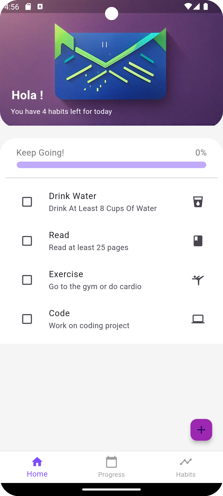
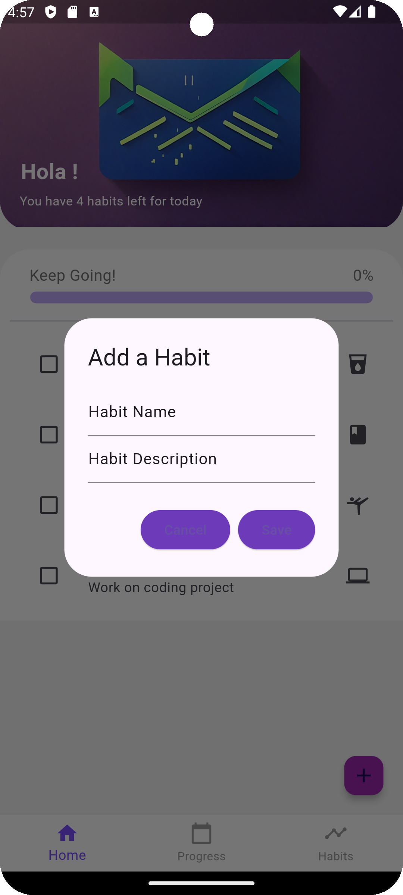
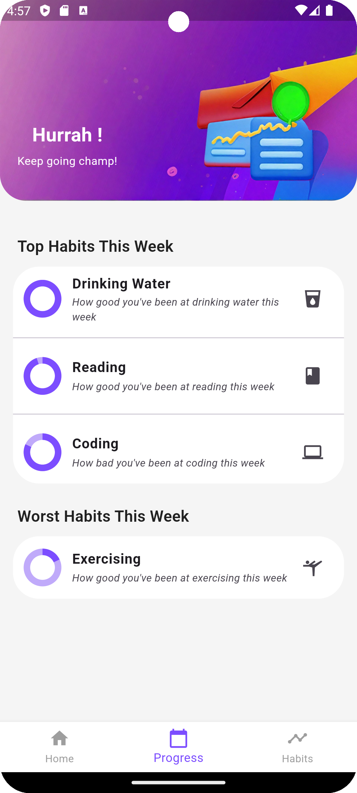
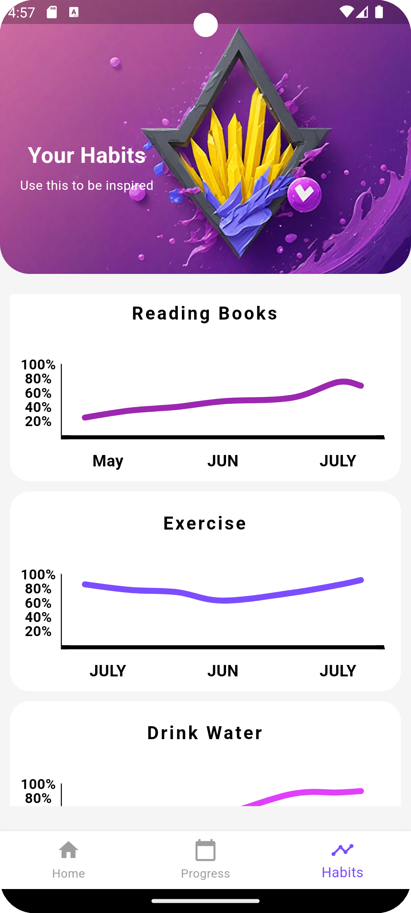

# 📱 Habito v2.0 – Habit Tracking Mobile Application


Habito is a modern Flutter mobile application designed to help users build, track, and maintain daily routines with real-time feedback, dynamic streak tracking, weekly performance insights, and responsive data charts.

---

## 🚀 What's New in Version 2.0 (Upgrade)

Habito v2.0 addresses and overcomes the limitations, hardcoded data, and lack of persistence found in the initial v1.0 release:

| Area | v1.0 (Initial) | v2.0 (Current Upgrade) |
| :--- | :--- | :--- |
| **Data Persistence** | ❌ None (lost on app close) | ✅ **Persistent Local Storage** using JSON + `SharedPreferences` |
| **Habit Management** | ⚠️ Add only (hardcoded icon & default text) | ✅ **Full CRUD**: Create with custom icons & colors, Edit, & Delete with confirmation |
| **Trend Charts** | ❌ 780 lines of hardcoded fake data | ✅ **Dynamic 7-Day Trend Charts** driven by real user logs |
| **Progress & Ranking**| ❌ Hardcoded percentages (100%, 95%, 82%) | ✅ **Real Dynamic Analytics**: Top habits, areas to focus, and weekly consistency |
| **Streak Engine** | ❌ Static placeholders | ✅ **Live Streak Counter** (consecutive days & personal bests) |
| **UI & Layout** | ⚠️ Fixed 513px heights (overflow bugs) | ✅ **Adaptive & Responsive Layouts** with Material 3 theming |
| **Architecture** | ⚠️ Untyped `List<dynamic>` in static file | ✅ **Typed Models & Reactive Service** (`HabitScope` / `ChangeNotifier`) |

---

## 🖼️ App Preview

<p float="left">
  
  
  
  
</p>

---

## ✨ Features

- **Daily Check-Ins:** One-tap habit completion with instant progress feedback and daily completion percentages.
- **Custom Habit Creation:** Choose from 14+ curated icons and personalized color palettes.
- **Live Streaks (🔥):** Keep your momentum going with automatic streak calculation.
- **Dynamic Weekly Insights:** Discover your top habits and areas that need attention based on calculated completion rates.
- **Interactive 7-Day Trends:** Responsive FL Chart line charts plotting cumulative consistency for each individual habit.
- **Edit & Delete:** Full control over your habits, with confirmation alerts before deleting.
- **Offline First:** Fast, reliable offline data storage that preserves state between sessions.

---

## 🛠️ Tech Stack

- **Framework:** [Flutter](https://flutter.dev) (Dart SDK `>=3.4.3 <4.0.0`)
- **State Management:** Reactive `ChangeNotifier` with `InheritedNotifier` (`HabitScope`)
- **Persistence:** `shared_preferences`
- **Charts:** `fl_chart`
- **Design:** Material 3 with custom gradients and iconography

---

## 📂 Project Structure

```text
lib/
├── main.dart                  # App bootstrap, Material 3 theming & navigation
├── models/
│   └── habit.dart             # Typed Habit model, JSON serialization & streak algorithms
├── pages/
│   ├── homePage.dart          # Daily check-in list, progress bar, add/edit/delete modals
│   ├── progressPage.dart      # Real weekly rankings, top performers, focus areas
│   └── habitsPage.dart        # Scrollable 7-day trend graphs per habit
└── services/
    ├── habit_service.dart     # Persistent CRUD storage & analytics engine
    ├── chartsBuilder.dart     # Dynamic FL Chart card widget
    └── lists.dart             # Icon choices and curated color palettes
```

---

## 🔮 Roadmap

- [ ] Push notification reminders
- [ ] Multi-week historical calendar heatmaps
- [ ] Dark Mode support
- [ ] Cloud sync and backup

---

## 🤝 Contributing

Contributions, issues, and feature requests are welcome! Feel free to check the issues tab.

---

## 📎 License

This project is licensed under the MIT License — see the [LICENSE](./LICENSE) file for details.
