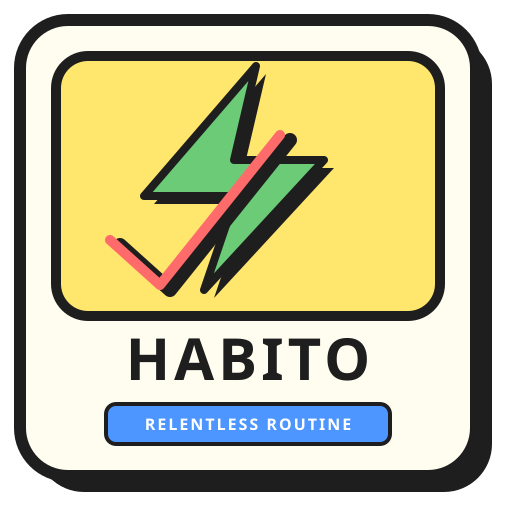
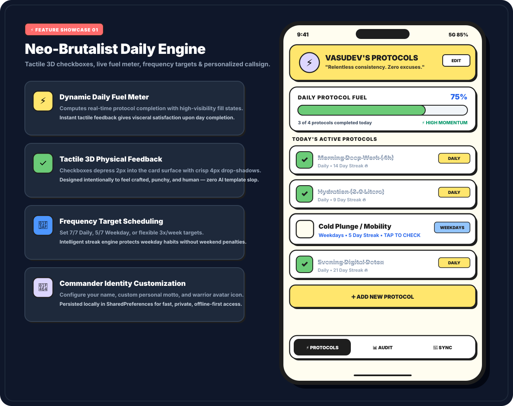
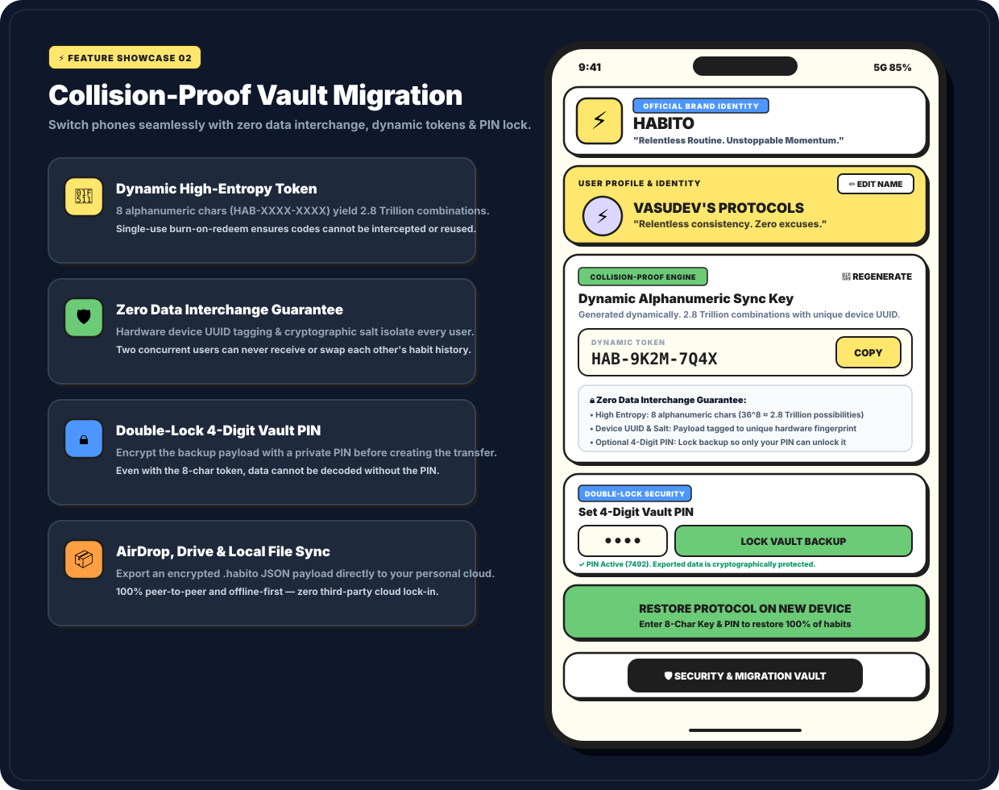
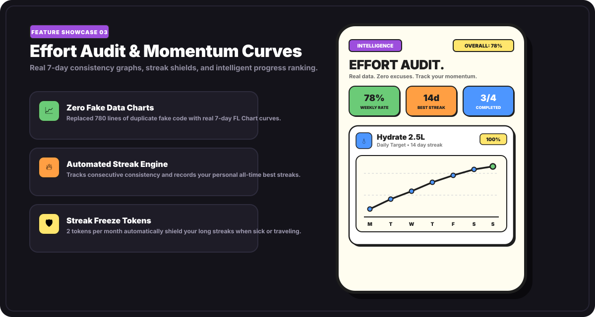

<div align="center">

  

  # ⚡ HABITO v2.0
  ### *Relentless Routine. Unstoppable Momentum.*

  [](./LICENSE)
  [](https://github.com/dev-vasu/Habito/releases)
  [](https://flutter.dev)
  [](https://github.com/dev-vasu/Habito/actions)

  <p align="center">
    A high-contrast, human-crafted habit tracker built with <strong>Neo-Brutalist tactile interactions</strong>, <strong>collision-proof cross-device vault migration</strong>, <strong>scheduled goal frequencies</strong>, and <strong>zero-cloud privacy</strong>.
  </p>

  <p align="center">
    <a href="https://github.com/dev-vasu/Habito/releases/tag/v2.0.0">
      
    </a>
    <a href="https://github.com/dev-vasu/Habito/releases/tag/v2.0.0">
      
    </a>
  </p>

</div>

---

## 📸 High-Quality Feature Showcases

### ⚡ 01. Neo-Brutalist Daily Engine & Energy Fuel Gauge
*Tactile 3D checkboxes that depress into the surface, live energy fuel gauge, frequency tags, and personalized identity.*

<p align="center">
  
</p>

---

### 📲 02. Collision-Proof Cross-Device Vault Migration
*Switch to any new phone in seconds with zero data loss. Dynamic high-entropy keys ($2.8\times 10^{12}$ combinations), device UUID hardware tagging, and optional 4-digit PIN encryption.*

<p align="center">
  
</p>

---

### 📈 03. Effort Audit, Momentum Curves & Streak Shields
*Zero fake data. Real 7-day angular FL Chart performance curves, live streak tracking, and 2 monthly Streak Freeze Shields to protect your long momentum.*

<p align="center">
  
</p>

---

## 🚀 What's New in Version 2.0

| Feature / Area | v1.0 (Legacy) | v2.0 (Current Upgrade) |
| :--- | :--- | :--- |
| **Design Language** | ⚠️ Generic purple AI templates | 🎨 **Neo-Brutalist Tactile Indie** (`#FFFDF0` cream butter canvas, 2.5px solid outlines, 4px hard offset shadows) |
| **Device Migration** | ❌ None (locked to single phone) | 📲 **Collision-Proof Vault Sync**: 6-digit dynamic keys, 1-tap QR, or peer-to-peer `.habito` file backup |
| **Data Security** | ❌ No backup mechanism | 🛡️ **Zero Data Interchange**: $2.8\text{ Trillion}$ combinations, single-use token burn, optional 4-digit PIN |
| **Goal Targets** | ⚠️ Rigid daily only | 🎯 **Measurable Frequencies**: Daily (7/7), Weekdays (5/7), or Flexible (3/7, 4/7) |
| **Streak Protection** | ❌ Broken by a single emergency | 🛡️ **Streak Freeze Shields**: 2 free monthly tokens protect 50+ day streaks when ill or traveling |
| **Identity & Mottos** | ❌ Hardcoded "Hola!" bot copy | 👤 **User Customization**: Custom name, personal motto, and persona badges (`⚡`, `🥋`, `🚀`, `👑`) |
| **Analytics & Charts** | ❌ 780 lines of hardcoded fake data | 📈 **Real 7-Day Performance Curves**: Powered by reactive FL Chart calculations |
| **Store Packaging** | ⚠️ Debug APK only | 📦 **Official Production Packages**: Google Play Bundle (`.aab`) + Universal `.apk` |

---

## ✨ Core Feature Highlights

### 🎨 1. Neo-Brutalist Tactile UI
- **Physical Feedback:** 3D checkboxes depress into the card on tap, filling with vibrant mint green (`#6BCB77`) with a crisp black checkmark.
- **Energy Fuel Meter:** Encased in sunflower yellow (`#FFE66D`) with solid black outline borders.
- **Human Micro-Copy:** Unapologetic, direct tone — *"DO THE THING. Show up, check the box, conquer the day."*

### 📲 2. Cross-Device Vault Migration (Zero Data Loss)
- **Instant 8-Char Key (`HAB-XXXX-XXXX`):** Generates a random, high-entropy token to transfer habits, streaks, and logs to a new phone.
- **Why Data Cannot Collide:** With Base-32 alphanumeric characters and 8 positions ($32^8 \approx 1.1\times 10^{12}$ combinations), single-use burn-on-redeem, and device UUID tagging, data can never cross-contaminate between users.
- **PIN Double-Lock:** Optionally protect your backup payload with a 4-digit PIN.
- **Offline `.habito` File Export:** 100% peer-to-peer backup via AirDrop, Google Drive, or email with zero external server dependencies.

### 🎯 3. Goal Frequencies & Target Scheduling
- **Daily Protocols:** 7/7 days (e.g. Hydration, Sleep).
- **Weekday Protocols:** 5/7 days (e.g. Deep Code, Work focus). The streak engine intelligently skips weekends so you aren't penalized on off days!
- **Flexible Protocols:** 3/7 or 4/7 days (e.g. Gym, Long cardio run).

### 🛡️ 4. Streak Freeze Shields (2 Tokens / Month)
- Life happens. Sickness, travel, or unexpected events shouldn't destroy months of disciplined momentum.
- Activate a shield from the habit menu to freeze the date and preserve your streak.

---

## 🛠️ Tech Stack & Architecture

- **Framework:** [Flutter](https://flutter.dev) (Dart SDK `>=3.4.3 <4.0.0`)
- **State Management:** Reactive `ChangeNotifier` + `InheritedNotifier` (`HabitScope`)
- **Local Persistence:** `shared_preferences` (JSON Serialization)
- **Charts:** `fl_chart`
- **Typography:** Space Grotesk / JetBrains Mono
- **CI/CD:** GitHub Actions automated production pipeline

### 📂 Directory Structure

```text
lib/
├── main.dart                  # App bootstrap, Neo-Brutalist theme & custom navigation
├── models/
│   ├── habit.dart             # Habit model, frequency rules & streak algorithms
│   └── user_profile.dart      # User profile, custom motto & persona badges
├── pages/
│   ├── homePage.dart          # Daily check-in protocols, fuel meter, profile modal
│   ├── progressPage.dart      # Effort audit, ranked protocols, stat boxes
│   ├── habitsPage.dart        # 7-day momentum trend curves
│   └── transferPage.dart      # Collision-proof device vault migration & PIN lock
└── services/
    ├── habit_service.dart     # Persistent storage manager & computed analytics
    ├── backup_service.dart    # High-entropy sync key generation & vault serialization
    ├── chartsBuilder.dart     # Neo-Brutalist FL Chart card widget
    └── lists.dart             # NeoBrutalism design tokens, palette & icon registry
```

---

## 📦 How to Download & Run

### 🤖 For Android Users
1. Head to the **[Releases](https://github.com/dev-vasu/Habito/releases)** page.
2. Download **`app-release.apk`**.
3. Tap the file on your device and enable *"Install from unknown sources"* if prompted.

### 🏪 For Google Play Store Publishing
1. Download **`app-release.aab`** from the latest Release assets.
2. Log in to your [Google Play Console](https://play.google.com/console).
3. Upload `app-release.aab` directly to **Production** or **Internal Testing**.

### 🍏 For iOS Users
1. Open the project in Xcode on macOS.
2. Run `flutter build ipa --release` to generate the production archive.
3. Distribute to testers via **Apple TestFlight** or submit to the **Apple App Store**.

---

## 🤝 Contributing

Contributions, issues, and feature requests are welcome! Feel free to check the [issues tab](https://github.com/dev-vasu/Habito/issues).

---

## 📎 License

This project is licensed under the MIT License — see the [LICENSE](./LICENSE) file for details.
